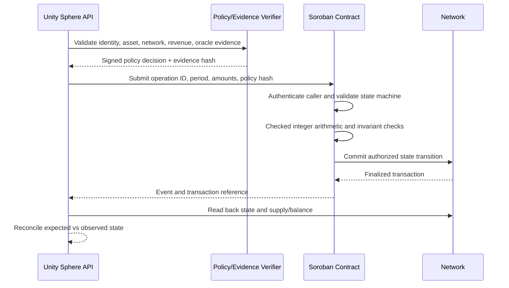
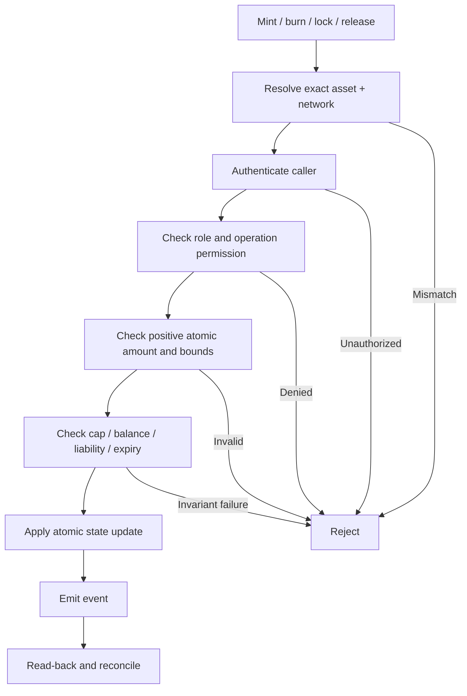

# Soroban Economic Execution Flow

## Authorized settlement

## Supply-operation gate

## Period close and allocation

No deployment, mint, burn or transfer is authorized by these diagrams. They specify the controls expected in implementation.

## PiRC-101 live market reference

The Soroban reference crate `contracts/pirc_101_monetary` consumes a typed median from `pirc_214_oracle_quorum_v3` and calculates `IPPR = median(PI/USD) * 10,000,000` on each snapshot. QWF is stored independently and changes only through an authorized, versioned adjustment with evidence hash, velocity and TVL inputs. It computes `Phi = (L_n * IPPR) / QWF` using integer arithmetic. The controller is reference-only: no REF mint, credit expansion, wallet conversion or payment is performed.
