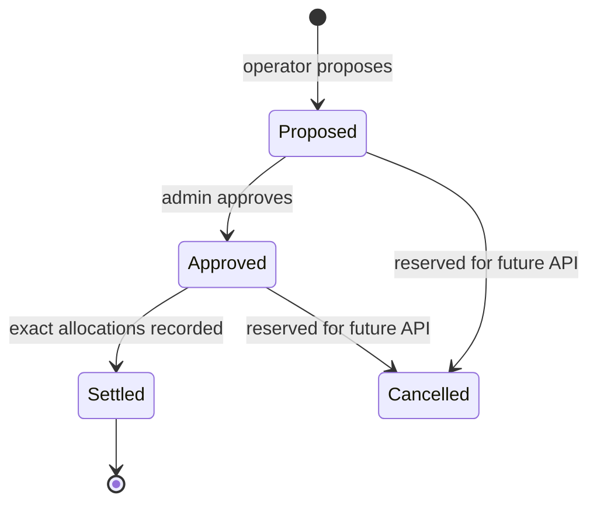

# Economic Settlement Contract — Implementation Notes

**Status:** Initial Soroban implementation on a draft branch. Not deployed, audited, or approved by Pi Network.

## Scope and trust boundary

The `economic_settlement` crate implements a bounded on-chain state machine for one declared asset per period. It records accounting inputs, approval, participant allocations and a one-time settlement digest. It does not custody assets, transfer tokens, establish an exchange price, verify an external reserve, or prove that an input digest corresponds to real-world revenue.

The operator is a trusted submitter of accounting inputs. The admin separately approves a proposed period. Independent evidence ingestion, multi-party approval, dispute resolution, asset transfer integration, and external oracle quorum remain future work.

## State machine



Only the transitions implemented in the contract are callable: Proposed → Approved → Settled. Cancelled is documented as a future extension, not an exposed transition.

## Accounting equations

Let all amounts be non-negative integer atomic units of the same asset:

```text
D = R - C
0 <= C <= R
A = sum(a_i)
0 <= A <= D
SettlementAllowed iff state = APPROVED and A = D
```

Where:
- `R`: collected revenue supplied by the authorized operator.
- `C`: aggregate deductions supplied by the authorized operator.
- `D`: distributable amount calculated by contract.
- `a_i`: allocation recorded for participant `i`.

The contract rejects a proposal when deductions exceed revenue and rejects settlement unless allocations exactly conserve the distributable amount. Allocation records are keyed by (period ID, participant address), preventing a participant from being allocated twice in one period.

## Methods

| Method | Authorization | Effect |
|---|---|---|
| `initialize(admin)` | admin | One-time administrator setup |
| `set_operator(operator, enabled)` | admin | Operator allowlist |
| `propose_period(...)` | enabled operator | Immutable accounting proposal |
| `approve_period(period_id)` | admin | Proposal approval |
| `record_allocation(...)` | enabled operator | Unique bounded-by-budget allocation |
| `settle_period(...)` | enabled operator | One-time finalization after exact allocation |
| `get_period(period_id)` | public | Read period state |
| `get_allocation(period_id, participant)` | public | Read allocation and evidence hash |

## Security properties and remaining work

- Authorization is required for admin and operator mutations.
- Initialization is one-time.
- Period IDs cannot be reused.
- Amounts use signed integer atomic units and are checked for non-negativity.
- Checked arithmetic prevents silent overflow.
- Deductions cannot exceed revenue.
- Allocation totals cannot exceed the distributable amount.
- Duplicate participant allocation and duplicate settlement are rejected.
- Settlement is impossible until allocations equal the distributable amount.
- Input/evidence/settlement hashes are references only; the contract does not validate off-chain evidence content.
- This first version does not implement token transfers, refunds, cancellation, disputes, multi-sig approval, policy governance, storage TTL extension, or Merkle proofs.
- The `asset_id` is an application identifier, not proof that the contract controls or recognizes an issuer's asset.

## Required release gates

1. Compile and test against the repository's pinned Soroban SDK and lockfile.
2. Run the shared economic golden-vector suite and contract-specific adversarial tests.
3. Add tests for unauthorized calls, duplicate initialization, duplicate period IDs, duplicate participant allocation, over-allocation, deductions greater than revenue, and replayed settlement.
4. Review storage TTL and maximum participant/period growth.
5. Add independent approval quorum and signed evidence validation before production use.
6. Integrate a separately reviewed token transfer contract only after asset identity and custody semantics are explicit.
7. Deploy only to a named test network after explicit authorization; capture transaction and state read-back evidence.

No GCV redemption, Pi price guarantee, reserve backing, or Pi Core Team endorsement is implied.
