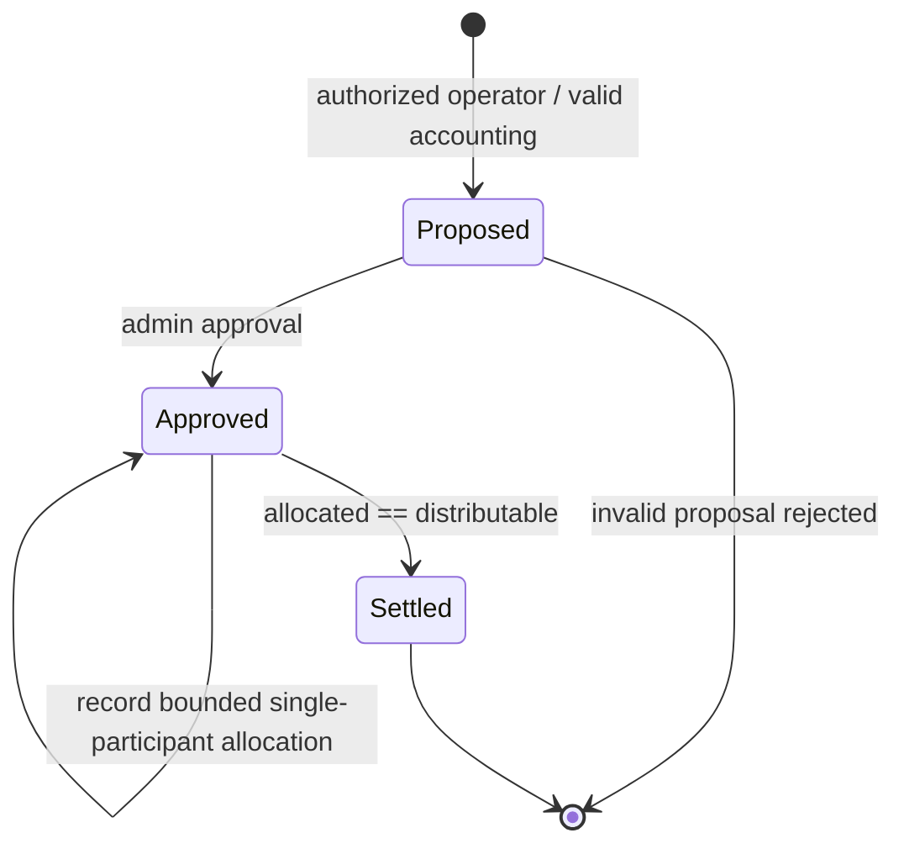

# Soroban Economic Settlement Contract — Initial Implementation

**Status:** Implemented as an initial contract crate on the follow-up branch; compilation, test execution, audit, and deployment remain unverified until CI evidence is available.

## Crate

- Path: `contracts/pirc_economic_settlement`
- Package: `pirc-economic-settlement`
- SDK: workspace-pinned `soroban-sdk = 22.0.11`
- Storage: instance storage for the admin; persistent keyed records for operators, periods, and participant allocations.
- Amount model: signed 128-bit interface values validated as non-negative integer atomic units. No floating-point arithmetic.

## State machine

A settled period is immutable through this interface. Corrections require a new period referencing the prior period in its external evidence package; no in-place reversal is provided.

## Accounting

For one asset and one period:

`D = operating_costs + tax + refunds_and_due_liabilities + reserve_replenishment + approved_commitments`

`N = collected_revenue - D`

Preconditions: every input is non-negative, all values use the same asset and atomic-unit scale, and `D <= collected_revenue`.

Settlement invariant:

`sum(allocation_amounts) = N`

The contract enforces `allocated <= N` while recording and requires exact equality at finalization. Arithmetic uses checked operations. The contract does not calculate market prices, exchange rates, reserve solvency, collateral value, GCV, or redemption rights.

## Authorization

- `initialize(admin)`: one-time, admin signature required.
- `set_operator(operator, enabled)`: admin signature required.
- `propose_period(...)`, `record_allocation(...)`, `settle_period(...)`: operator signature and allowlist membership required.
- `approve_period(period_id)`: admin signature required.

## Entry points

| Method | Purpose |
|---|---|
| `initialize` | Set the administrator once |
| `set_operator` | Manage the operator allowlist |
| `propose_period` | Store immutable accounting inputs and derived distributable amount |
| `approve_period` | Freeze proposal for allocation |
| `record_allocation` | Add one unique participant allocation with evidence hash |
| `settle_period` | Finalize once after exact conservation |
| `get_period` | Read period state |
| `get_allocation` | Read participant allocation and evidence hash |

## Explicit limitations and next gates

1. The contract records allocations; it does not transfer tokens. A separately reviewed asset-transfer adapter is required before any payment semantics can be claimed.
2. Allocation pagination and bounded batch orchestration belong in the client/relayer layer; participant arrays are not stored in a single contract value.
3. Evidence hashes are commitments only. They do not prove identity, eligibility, provenance, or data availability.
4. Policy version and input digest are recorded but policy approval/signature verification is not yet implemented.
5. Persistent storage TTL/renewal and resource budgets require measured tests.
6. The initial unit tests must pass in the repository's pinned workspace CI before parity can be claimed.
7. No Testnet deployment, Mainnet readiness, independent audit, official Pi Network endorsement, reserve backing, peg, or redemption promise is implied.

## Repository consistency notes (2026-11-03)

- The canonical implementation described by this document is `contracts/pirc_economic_settlement`.
- The workspace also currently discovers `contracts/economic_settlement`, a second contract crate with overlapping settlement behavior but a different public method signature and state representation. This duplication is a release-blocking maintainability decision: maintainers must either consolidate it into the canonical crate or document a deliberate compatibility reason before the workspace can be considered interface-stable.
- The focused test source `contracts/pirc_economic_settlement/src/test.rs` is now explicitly included from `lib.rs` via `#[cfg(test)] mod test;`. Previously the file existed but was not wired into the crate's test module tree. CI must execute the tests before any test-pass claim is made.
- Added regression coverage for duplicate participant allocation and allocations exceeding the period distributable amount. These tests are authored but not yet confirmed as passing by a completed workflow run.
